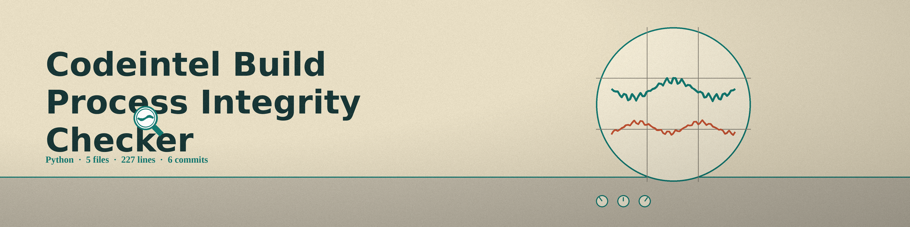

# codeintel-Build-Process-Integrity-Checker
Verifies the integrity of the build process by checking build scripts, dependency files, and compiler settings files against supplied SHA256 baseline hashes, and alerts on mismatches. The build script is the primary artifact: a named build script with no baseline hash exits 1. Any other named file with no baseline hash is logged as skipped, one line per file, and a closing summary counts checked and skipped files. A run that checked zero files exits 1. If a scanner the operator asked for with --run-bandit, --run-flake8, --run-pylint, or --run-pyre is missing or returns non zero, the run ends with a line naming the scanner outcomes and exits 1.

## Install
`git clone https://github.com/ShadowStrikeHQ/codeintel-build-process-integrity-checker`

## Usage
`./codeintel-build-process-integrity-checker [params]`

## Parameters
- `--build-script`: No description provided
- `--dependency-file`: No description provided
- `--compiler-settings`: No description provided
- `--baseline-hash-build-script`: Baseline SHA256 hash of the build script. If provided, script hash will be checked against it.
- `--baseline-hash-dependency-file`: Baseline SHA256 hash of the dependency file. If provided, dependency file hash will be checked against it.
- `--baseline-hash-compiler-settings`: Baseline SHA256 hash of the compiler settings file. If provided, compiler settings file hash will be checked against it.
- `--run-bandit`: Run Bandit security scanner.
- `--run-flake8`: Run Flake8 code linter.
- `--run-pylint`: Run Pylint code analyzer.
- `--run-pyre`: Run Pyre type checker.
- `--offensive-scan`: No description provided

## License
Copyright (c) ShadowStrikeHQ
